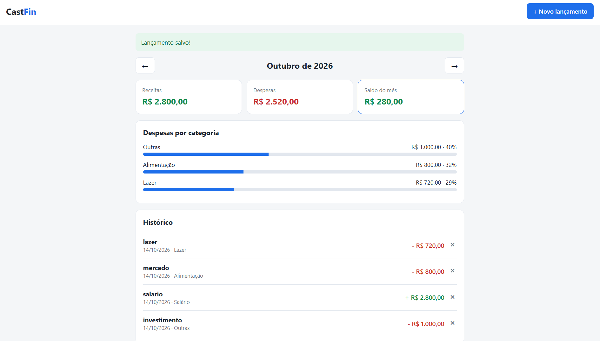
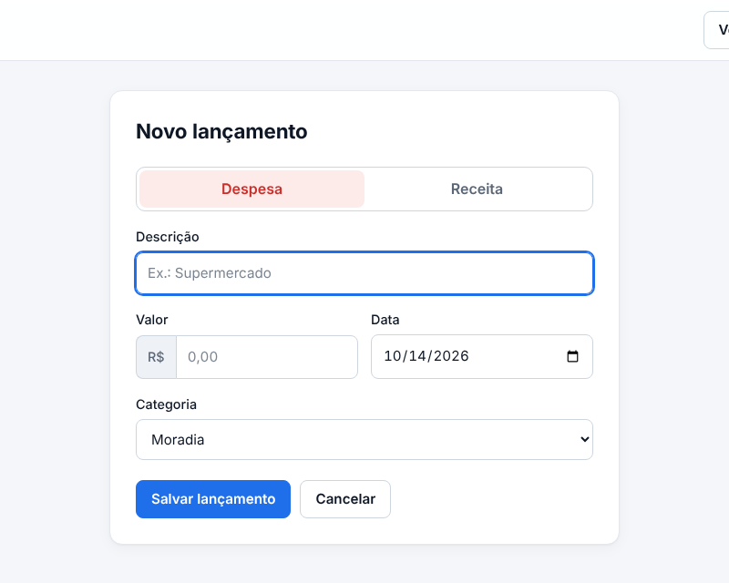

# 🪙 CastFin

[](https://www.python.org/)
[](https://flask.palletsprojects.com/)
[](https://www.sqlite.org/)

O **CastFin** é uma aplicação web leve e intuitiva de controle financeiro pessoal, desenvolvida com foco em simplicidade usando **Python**, **Flask** e **SQLite**.

> 🚧 **Projeto em desenvolvimento.** Este é um projeto de estudo, construído aos poucos. O que está planejado pode mudar.

---

## 📸 Pré-visualização do Sistema

<div align="center">
  <h3>Dashboard Mensal</h3>
  

  <br/><br/>

  <h3>Tela de Novo Lançamento</h3>
  
</div>

---

## ✨ Funcionalidades

### Atualmente implementadas (✅)
- **Saldo do mês em destaque:** quanto sobrou e quanto da receita virou despesa, com comparação com o mês anterior.
- **Indicadores:** receitas, despesas, taxa de poupança e gasto médio por dia.
- **Evolução dos últimos 6 meses:** receitas e despesas lado a lado; clique em um mês para abri-lo.
- **Despesas por categoria:** gráfico em anel, valores, percentuais e maior despesa do mês.
- **Gestão completa de lançamentos:** cadastrar, **editar** e excluir receitas e despesas.
- **Busca e filtros:** por descrição, tipo (receita/despesa) e categoria.
- **Exportação:** baixe os lançamentos do mês em CSV, que abre direto no Excel.
- **Tema claro e escuro:** segue a configuração do seu sistema.
- **Responsivo:** funciona no computador e no celular.

### Planejadas (⏳)
- [ ] Orçamento limite por categoria.
- [ ] Gráficos analíticos de fluxo de caixa anual.
- [ ] Categorias editáveis pela interface (hoje ficam em `app.py`).

---

## 🛠️ Tecnologias utilizadas

- **Backend:** Python 3 com [Flask](https://flask.palletsprojects.com/)
- **Banco de dados:** SQLite (criado automaticamente)
- **Frontend:** HTML5 e CSS3 responsivo, sem frameworks JavaScript; gráficos feitos só com CSS

---

## 🚀 Como executar o projeto

Certifique-se de ter o **Python** instalado antes de prosseguir.

1. Clone o repositório ou baixe os arquivos do projeto.
2. Abra o terminal **na pasta raiz do projeto** (onde está o arquivo `app.py`).

### No Windows (CMD ou PowerShell)

```
python -m venv .venv
.venv\Scripts\activate
pip install -r requirements.txt
python app.py
```

*Dica: você também pode iniciar o sistema dando dois cliques em `run_windows.bat`. Se o Windows bloquear o arquivo baixado, use os comandos acima.*

### No Linux / macOS

```
python3 -m venv .venv
source .venv/bin/activate
pip install -r requirements.txt
python app.py
```

3. Com o servidor rodando, abra o navegador em **http://127.0.0.1:5000**

*O banco de dados local `castfin.db` é gerado automaticamente na primeira execução.*

---

## 📂 Estrutura de diretórios

```text
castfin/
├── app.py                  # Lógica da aplicação e rotas Flask
├── requirements.txt        # Dependências do projeto
├── run_windows.bat         # Execução rápida no Windows
├── docs/
│   ├── dashboard.png       # Captura de tela do dashboard
│   └── form.png            # Captura de tela do formulário
├── templates/              # Páginas HTML (Jinja2)
│   ├── base.html
│   ├── dashboard.html
│   └── form.html
└── static/
    └── css/
        └── style.css       # Estilos da interface
```

---

## ⚙️ Decisões técnicas

- **Precisão monetária:** os valores são armazenados como **inteiros (centavos)**, evitando erros de arredondamento de ponto flutuante.
- **Padronização de datas:** gravadas no formato `AAAA-MM-DD` e exibidas como `DD/MM/AAAA`.
- **Segurança de consultas:** consultas SQL parametrizadas, que evitam *SQL Injection*.

---

## ⚠️ Aviso de segurança

A `secret_key` em `app.py` serve apenas para desenvolvimento local. **Não use essa configuração em produção.**
