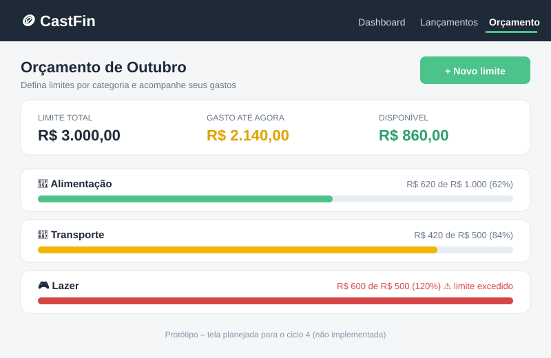

# 🪙 CastFin

[](https://www.python.org/)
[](https://flask.palletsprojects.com/)
[](https://www.sqlite.org/)
[](#-metodologias-utilizadas)

> 🚧 **Projeto em desenvolvimento.** Este é um projeto de estudo da disciplina de Engenharia de Software, construído aos poucos. O que está planejado pode mudar.

---

## 📑 Sumário

1. [Sobre o Projeto](#-sobre-o-projeto)
2. [Funcionalidades](#-funcionalidades)
3. [Tecnologias, Ferramentas e Infraestrutura](#️-tecnologias-ferramentas-e-infraestrutura)
4. [Metodologias Utilizadas](#-metodologias-utilizadas)
5. [Projeto de Interface](#-projeto-de-interface)
6. [Como executar o projeto](#-como-executar-o-projeto)
7. [Estrutura de diretórios](#-estrutura-de-diretórios)
8. [Decisões técnicas](#️-decisões-técnicas)
9. [Aviso de segurança](#️-aviso-de-segurança)

---

## 📖 Sobre o Projeto

O **CastFin** é uma aplicação web leve e intuitiva de **controle financeiro pessoal**. Ele ajuda o usuário a registrar receitas e despesas, entender para onde o dinheiro está indo e acompanhar a evolução dos gastos mês a mês.

**Problema que resolve:** muitas pessoas não sabem quanto sobra no fim do mês, e aplicativos financeiros costumam ser complexos demais. O CastFin aposta na **simplicidade**: poucas telas, informação clara e nenhum cadastro complicado.

**Público-alvo:** pessoas que querem organizar suas finanças sem planilhas e sem apps pesados.

---

## ✨ Funcionalidades

### Atualmente implementadas (✅)

- **Saldo do mês em destaque:** quanto sobrou e quanto da receita virou despesa, com comparação com o mês anterior.
- **Indicadores:** receitas, despesas, taxa de poupança e gasto médio por dia.
- **Evolução dos últimos 6 meses:** receitas e despesas lado a lado; clique em um mês para abri-lo.
- **Despesas por categoria:** gráfico em anel, valores, percentuais e maior despesa do mês.
- **Gestão completa de lançamentos:** cadastrar, **editar** e excluir receitas e despesas.
- **Busca e filtros:** por descrição, tipo (receita/despesa) e categoria.
- **Exportação:** baixe os lançamentos do mês em CSV, que abre direto no Excel.
- **Tema claro e escuro:** segue a configuração do seu sistema.
- **Responsivo:** funciona no computador e no celular.

### Planejadas (⏳)

- [ ] Orçamento limite por categoria (veja o [protótipo](#tela-planejada-orçamento-por-categoria)).
- [ ] Gráficos analíticos de fluxo de caixa anual.
- [ ] Categorias editáveis pela interface (hoje ficam em `app.py`).
- [ ] Login de usuários e banco PostgreSQL para uso em produção.

---

## 🛠️ Tecnologias, Ferramentas e Infraestrutura

### Linguagens e frameworks

| Camada | Tecnologia | Por que foi escolhida |
|---|---|---|
| Backend | **Python 3** + **Flask** | Simples, rápido de aprender e ótimo para projetos pequenos |
| Templates | **Jinja2** | Já vem com o Flask e evita a necessidade de um framework JS |
| Frontend | **HTML5 + CSS3** responsivo | Sem dependências; os gráficos são feitos só com CSS |
| Banco de dados | **SQLite** | Zero configuração; o arquivo `castfin.db` é criado sozinho |

### Ferramentas de desenvolvimento

| Finalidade | Ferramenta |
|---|---|
| Controle de versão | **Git** e **GitHub** |
| Editor de código | **Visual Studio Code** |
| Ambiente isolado | **venv** (ambiente virtual do Python) |
| Prototipação de telas | **Figma** e capturas do próprio sistema |
| Gestão de tarefas | **GitHub Issues** e **GitHub Projects** (quadro Kanban) |
| Testes | **pytest** (planejado) |
| Documentação | **Markdown** |

### Infraestrutura

| Ambiente | Configuração |
|---|---|
| **Desenvolvimento (atual)** | Máquina local, `python app.py` na porta 5000, SQLite em arquivo |
| **Produção (planejada)** | Deploy em nuvem no **Render** (ou Railway), servidor **Gunicorn**, banco **PostgreSQL** gerenciado, HTTPS automático |
| **Integração contínua (planejada)** | **GitHub Actions** rodando testes a cada Pull Request |

```
 Usuário ──HTTPS──► Render (Gunicorn + Flask) ──► PostgreSQL gerenciado
                          ▲
                          │ deploy automático a cada merge na main
                       GitHub ──► GitHub Actions (testes)
```

> ℹ️ A infraestrutura de produção é uma **proposta de projeto**: hoje o sistema roda apenas localmente.

---

## 📋 Metodologias Utilizadas

### Modelo de desenvolvimento: Espiral

Escolhi o modelo **Espiral** em vez do **Cascata**. O motivo:

| Critério | Cascata | Espiral | Vantagem para o CastFin |
|---|---|---|---|
| Requisitos | Fechados no início | Evoluem a cada volta | Eu só descobri o que o dashboard precisava depois de usá-lo |
| Entrega | Só no final | Uma versão utilizável por ciclo | Dá para testar o sistema desde o 1º ciclo |
| Riscos | Descobertos tarde | Analisados em todo ciclo | Erros (ex.: arredondamento de valores) foram pegos cedo |
| Mudanças | Caras | Esperadas | Projeto de estudo, o escopo muda conforme eu aprendo |

O **Cascata** só faria sentido se todos os requisitos fossem conhecidos e imutáveis desde o começo, o que não é o caso de um projeto de estudo feito em partes.

### Os ciclos da espiral

Cada volta passa pelas mesmas quatro etapas: **1) planejamento, 2) análise de riscos, 3) desenvolvimento e testes, 4) avaliação**.

| Ciclo | Objetivo | Principal risco analisado | Status |
|---|---|---|---|
| 1 | Cadastro e listagem de lançamentos | Erros de arredondamento em dinheiro | ✅ Concluído |
| 2 | Dashboard mensal e indicadores | Consultas SQL lentas ou inseguras | ✅ Concluído |
| 3 | Edição, busca, filtros e exportação CSV | Complexidade da tela | ✅ Concluído |
| 4 | Orçamento por categoria | Mudança no modelo de dados | ⏳ Planejado |
| 5 | Login, PostgreSQL e deploy | Segurança e migração de dados | ⏳ Planejado |

### Uso do Git e GitHub

**Fluxo de branches (versão simplificada do GitHub Flow):**

- `main`: sempre estável e funcionando; é a versão "entregável".
- `feature/<nome>`: uma branch para cada funcionalidade (ex.: `feature/filtro-categoria`).
- `fix/<nome>`: correções de bugs (ex.: `fix/formato-data`).
- `docs/<nome>`: mudanças só de documentação.

**Padrão de commits** (baseado em *Conventional Commits*):

```
feat: adiciona filtro por categoria
fix: corrige arredondamento no saldo mensal
docs: atualiza README com metodologias
style: ajusta cores do tema escuro
refactor: separa consultas do dashboard
```

**Rotina de trabalho:**

1. Criar uma *Issue* descrevendo a tarefa.
2. Criar a branch a partir da `main`: `git checkout -b feature/nome`.
3. Fazer commits pequenos e frequentes.
4. Abrir um **Pull Request**, mesmo trabalhando sozinho, para treinar o fluxo de revisão.
5. Fazer o *merge* na `main` e apagar a branch.
6. Ao final de cada ciclo da espiral, marcar uma versão com **tag** (`v0.1`, `v0.2`...).

**Outras práticas:**

- `.gitignore` para não versionar `.venv/`, `castfin.db` e arquivos temporários.
- `requirements.txt` para qualquer pessoa reproduzir o ambiente.
- Nunca commitar chaves secretas (veja o [aviso de segurança](#️-aviso-de-segurança)).

---

## 🎨 Projeto de Interface

### Dashboard Mensal

Visão geral do mês: saldo, indicadores, evolução dos últimos 6 meses e despesas por categoria.


### Tela de Novo Lançamento

Formulário para cadastrar (ou editar) uma receita ou despesa.


### Tela planejada: Orçamento por categoria

Protótipo da funcionalidade do ciclo 4: o usuário define um limite mensal por categoria e acompanha o quanto já gastou, com cores de alerta (verde, amarelo e vermelho).



### Princípios de design

- **Simplicidade:** o essencial na primeira tela, sem menus escondidos.
- **Legibilidade:** números grandes e cores para diferenciar receita e despesa.
- **Acessibilidade:** tema claro/escuro e layout responsivo para celular.

---

## 🚀 Como executar o projeto

Certifique-se de ter o **Python** instalado antes de prosseguir.

1. Clone o repositório ou baixe os arquivos do projeto.
2. Abra o terminal **na pasta raiz do projeto** (onde está o arquivo `app.py`).

### No Windows (CMD ou PowerShell)

```
python -m venv .venv
.venv\Scripts\activate
pip install -r requirements.txt
python app.py
```

*Dica: você também pode iniciar o sistema dando dois cliques em `run_windows.bat`. Se o Windows bloquear o arquivo baixado, use os comandos acima.*

### No Linux / macOS

```
python3 -m venv .venv
source .venv/bin/activate
pip install -r requirements.txt
python app.py
```

3. Com o servidor rodando, abra o navegador em **<http://127.0.0.1:5000>**

*O banco de dados local `castfin.db` é gerado automaticamente na primeira execução.*

---

## 📂 Estrutura de diretórios

```
castfin/
├── app.py                        # Lógica da aplicação e rotas Flask
├── requirements.txt              # Dependências do projeto
├── run_windows.bat               # Execução rápida no Windows
├── docs/
│   ├── dashboard.png             # Captura de tela do dashboard
│   ├── form.png                  # Captura de tela do formulário
│   └── prototipo-orcamento.svg   # Protótipo da tela de orçamento (planejada)
├── templates/                    # Páginas HTML (Jinja2)
│   ├── base.html
│   ├── dashboard.html
│   └── form.html
└── static/
    └── css/
        └── style.css             # Estilos da interface
```

---

## ⚙️ Decisões técnicas

- **Precisão monetária:** os valores são armazenados como **inteiros (centavos)**, evitando erros de arredondamento de ponto flutuante.
- **Padronização de datas:** gravadas no formato `AAAA-MM-DD` e exibidas como `DD/MM/AAAA`.
- **Segurança de consultas:** consultas SQL parametrizadas, que evitam *SQL Injection*.
- **Sem framework JavaScript:** menos dependências e carregamento mais rápido.

---

## ⚠️ Aviso de segurança

A `secret_key` em `app.py` serve apenas para desenvolvimento local. **Não use essa configuração em produção.** Em produção, a chave deve vir de uma variável de ambiente.

---

## 👤 Autor

Desenvolvido por **Arthur Castro** ([@arthurcastrox](https://github.com/arthurcastrox)) como projeto da disciplina de Engenharia de Software.
